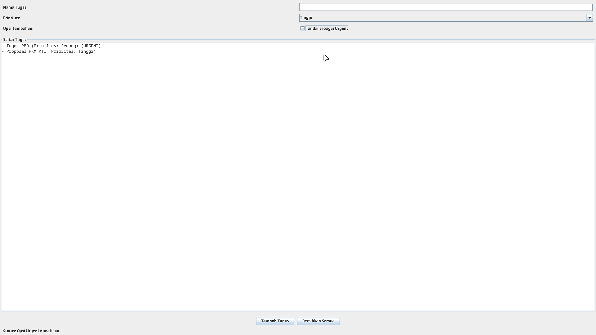

**Nama:** Muharromi Ali Ilham
**NIM :** F1D02410082
---

## Komponen utama GUI yang digunakan

### 1. Top-level Container Class
Class utama yang membuat frame tempat menampung seluruh fungsi dan method. `(public class LatihanGUI extends JFrame)`.

### 2. Intermediate Container Class
Frame yang diletakkan di dalam top-level container untuk mengelompokkan dan mengatur komponen lain. `(panelForm, JTextArea)`.

### 3. Atomic Component Class
- JLabel: Menampilkan keterangan field input (Nama Tugas, Prioritas, Opsi Tambahan) serta status bar di bagian bawah (lblStatus).
- JTextField: Kolom input teks satu baris untuk mengetik nama tugas (txtJudul).
- JComboBox: Menu dropdown untuk memilih tingkat prioritas (Rendah, Sedang, Tinggi).
- JCheckBox: Kotak centang untuk menandai tugas sebagai [URGENT].
- JButton: Tombol aksi Tambah Tugas dan Bersihkan Semua.
- JTextArea: Area teks multi-baris (read-only) untuk menampilkan daftar tugas yang telah dimasukkan.
- JOptionPane: Menampilkan dialog peringatan jika pengguna menekan tambah saat kolom nama tugas kosong.

### 4. Layout Classes
Bagian yang mengatur posisi dan ukuran komponen di dalam container secara otomatis.
- BorderLayout: Mengatur kerangka utama JFrame.
- GridLayout: Menyusun elemen pada panelForm menjadi  3 baris × 2 kolom dengan jarak antar elemen 8px.
- FlowLayout: Membuat tombol "Tambah Tugas" dan "Bersihkan Semua" secara horizontal di posisi tengah pada panelTombol.

### 5. Event Listener (Interfaces & Adapter Classes)

| Jenis | Class / Interface | Method yang Di-override | Fungsi dalam Aplikasi |
| :--- | :--- | :--- | :--- |
| Listener Interface | java.awt.event.ActionListener | actionPerformed(ActionEvent e) | Menambahkan tugas saat tombol Tambah Tugas diklik dan menghapus daftar saat Bersihkan Semua diklik. |
| Listener Interface | java.awt.event.ItemListener | itemStateChanged(ItemEvent e) | Memperbarui teks status bar secara langsung saat checkbox Urgent dicentang atau tidak dicentang. |
| Adapter Class | java.awt.event.MouseAdapter | mouseEntered(MouseEvent e), mouseExited(MouseEvent e) | Memberi efek hover warna biru muda pada tombol Tambah Tugas dan warna merah pada tombol Hapus Semua serta menampilkan status di pojok kiri bawah. |
| Adapter Class | java.awt.event.KeyAdapter | keyPressed(KeyEvent e) | Membuat tombol Enter di JTextField sebagai shortcut untuk langsung menambahkan tugas. |

---

## Screenshot Aplikasi



---

## Cara Menjalankan

```bash
javac LatihanGUI.java
java LatihanGUI
```